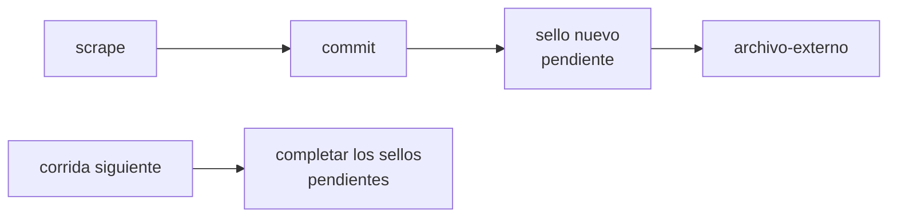

# Plan: sellos de tiempo en Bitcoin

Objetivo: que cualquiera pueda comprobar, sin confiar en nosotros, que **un archivo que publicamos no cambió desde la fecha en que dijimos tenerlo**. Se hace anclando los sha256 que ya calculamos en la cadena de Bitcoin con [OpenTimestamps](https://opentimestamps.org), gratis y sin subir ningún dato.

Fecha: 18/10/2026. Estado: propuesta, sin empezar. En esta etapa no se integra. Falta decidir las preguntas abiertas del final.

## Por qué

- **Hoy la prueba de que no tocamos un dato depende de nosotros.** El `manifest.jsonl` guarda el sha256 y la fecha de cada descarga, y es de solo agregar, pero lo escribimos nosotros. El historial de git ayuda a fechar, pero se puede reescribir (`rebase`, `push --force`) y las fechas de los commits se pueden inventar.
- **Un proyecto que le pide transparencia al Estado tiene que poder mostrar la propia.** Si un organismo dice «ese PDF nunca dijo eso» o alguien sospecha que ajustamos una cifra, hace falta una respuesta que no sea «creénos».
- **Bitcoin sirve justo para esto.** Nadie puede cambiar una fecha hacia atrás en la cadena. Si un hash quedó anclado en un bloque, ese contenido existía en ese momento, y cualquiera lo verifica con su propia copia de la cadena o con un explorador público.
- **Subir los datos no tiene sentido; sellar sus hashes sí.** Guardar los datos en Bitcoin (con Ordinals, por ejemplo) costaría cientos o miles de dólares por MB (`data/processed` pesa 43 MB y `data/raw` 534 MB), los dejaría sin forma de corregirlos y expondría para siempre nombres de agentes públicos, en contra del derecho a pedir que se rectifiquen o se borren (Ley 25.326). Un sello son 32 bytes y no dice nada del contenido.

## Qué prueba y qué no

| Prueba | No prueba |
|---|---|
| Que el archivo con ese sha256 existía, como muy tarde, en la fecha del bloque | Que el Estado lo publicó: eso lo prueba la captura de la Wayback Machine (ver `docs/procesos/datos-y-archivo.md`) |
| Que nuestra copia de hoy es idéntica byte a byte a la que sellamos | Que el archivo era correcto al bajarlo: si lo hubiéramos alterado antes de sellarlo, el sello lo certificaría igual |
| Que una cifra publicada en `data/processed` no se cambió en silencio: una corrección deja un sello nuevo y el viejo sigue ahí | Quién lo selló: un sello no tiene autor (ver «Firma» en las preguntas abiertas) |

La segunda fila de la derecha se achica sellando **en la misma corrida de GitHub Actions que descarga**, cuyos registros son públicos: entre que el archivo llega y se sella pasan minutos, y no interviene ninguna persona.

Las tres pruebas se complementan:

| Qué | Quién lo certifica | Qué dice |
|---|---|---|
| Captura de la Wayback Machine | archive.org | «Esta URL oficial mostraba esto en esta fecha» |
| Ítem de archive.org y `manifest.jsonl` | archive.org y nosotros | «Esta es la copia que bajamos, de esta URL» |
| Sello de OpenTimestamps | La cadena de Bitcoin | «Esta copia existía en esta fecha y no cambió desde entonces» |

## Cómo funciona OpenTimestamps

1. Se calcula el sha256 de un archivo y se manda solo el hash (32 bytes) a los servidores de calendario públicos (los que trae el cliente por defecto: dos de OpenTimestamps, uno de Eternity Wall y uno de Catallaxy, mantenidos por distintas personas). El contenido nunca sale de la máquina.
2. Cada calendario junta los hashes de miles de personas en un árbol de Merkle y ancla **una sola raíz** por transacción de Bitcoin. Esa transacción la pagan ellos: para nosotros es gratis.
3. En el momento devuelven un archivo `.ots` «pendiente». Unas horas después, cuando la transacción ya está en un bloque, el `.ots` se **completa** con el camino desde nuestro hash hasta el bloque. Desde ahí no depende más de los calendarios: alcanza con el archivo, el `.ots` y la cadena de Bitcoin.
4. Para verificar, cualquiera recalcula el camino y comprueba que la raíz está en ese bloque: con `ots verify` y su propio nodo, o arrastrando el archivo y el `.ots` a opentimestamps.org.

## Propuesta

### Qué se sella

En cada corrida de actualización, un archivo de texto con los sha256 de todo lo que cambió en esa corrida, ordenado por ruta:

```
<sha256>  data/raw/boletin-oficial/2026-10-20/indice.html
<sha256>  data/processed/compras/compras.csv
…
```

- **Lo crudo:** las líneas nuevas de cada `manifest.jsonl`. Su sha256 ya existe y es el del **original sin comprimir** (`packages/core/src/fetch.ts`), así que quien verifica descomprime antes de calcularlo. Los HTML usan la huella del texto visible (`huella()`), no los bytes: para ellos el sello cubre lo que ve una persona, y conviene sumar el sha256 de los bytes tal como quedaron guardados para no tener que explicar la diferencia (pregunta abierta).
- **Lo procesado:** el sha256 de cada CSV de `data/processed` y su `.meta.json` que cambió. Hoy son 48 CSV.
- **Se sella esa lista, no cada archivo.** Es un solo hash por corrida. Para verificar un archivo, se busca su línea en la lista, se verifica el sello de la lista y se comprueba el hash del archivo. Así hay un `.ots` por corrida y no 9.000.

### Dónde se guarda

`data/timestamps/<AAAA-MM-DD>.txt` (la lista) y `data/timestamps/<AAAA-MM-DD>.txt.ots` (el sello), de solo agregar como `data/raw`. Si hay dos corridas el mismo día, la segunda lleva la hora en el nombre, igual que los crudos. Las dos cosas también suben al ítem de archive.org del mes, para que se puedan verificar sin el repo.

### Cuándo corre



- **Sellar:** un paso al final del job `commit` de `.github/workflows/actualizar-datos.yml`, con lo que entró en ese commit. Hoy corre los lunes y el día 3 de cada mes.
- **Completar:** al empezar cada corrida se completan los `.ots` pendientes de las anteriores (`ots upgrade`). Como las corridas están separadas por días, para entonces el bloque ya existe. El `.ots` completo pisa al pendiente: es el único archivo de `data/` que cambia, y solo para pasar de «pendiente» a «completo» sin tocar el hash sellado.
- **A mano:** `bun run sellar` (sellar lo pendiente de sellar y completar lo que se pueda), para usar junto con `bun run actualizar`.

### Cómo se muestra

- Una sección «Cómo verificar que no cambiamos un dato» en la página de metodología, con los pasos para una persona sin conocimientos técnicos (opentimestamps.org) y para quien quiera hacerlo con su propio nodo.
- En la hoja de cada dato, junto a «Copia en archive.org», un link «Sello de tiempo» a la lista y el `.ots` de la corrida que lo trajo. Pide la skill `diseno` y un evento en `analytics-catalog.ts`.
- Nada de lenguaje cripto en la interfaz: se habla de «sello de tiempo» y de «registro público que nadie puede cambiar hacia atrás», y Bitcoin aparece solo en la explicación.

## Costo

| Qué | Cuánto | De qué cupo |
|---|---|---|
| Transacciones de Bitcoin | Nada: las pagan los calendarios de OpenTimestamps | — |
| GitHub Actions | Segundos por corrida (hashes ya calculados y unos pocos pedidos HTTP) | Gratis en un repo público |
| Tamaño del repo | La lista: unas decenas de KB por corrida. El `.ots`: unos pocos KB. Menos de 10 MB por año | Repo de GitHub |
| Cloudflare | Nada: los archivos estáticos no cuentan para el límite | — |

Cumple con el [costo cero](../procesos/arquitectura.md#costo-cero).

## Riesgos

- **Que los calendarios dejen de funcionar.** Un sello se pide a varios a la vez y alcanza con que uno responda. Un `.ots` ya completo no depende de ellos. Si todos se caen, el paso falla sin cortar la actualización, y el sello se pide en la corrida siguiente (queda un hueco de fechas, no un dato perdido).
- **Que se pierda un `.ots` pendiente antes de completarse.** Se commitea en el mismo push, así que solo se pierde si se pierde el commit.
- **Que se lea como un proyecto cripto.** Por eso el texto visible no habla de Bitcoin como protagonista y no hay token, NFT ni nada que se compre.
- **Lo ya descargado no se puede sellar hacia atrás.** El primer sello de todo `data/raw` prueba que existía *desde la fecha del sello*, no desde la descarga. Para las fechas anteriores siguen valiendo los ítems y capturas de archive.org, que tienen su propia fecha. Se dice así en la página de metodología.

## Etapas

1. Decidir las preguntas abiertas.
2. Prueba local con una sola fuente: armar la lista, sellarla, esperar a que se complete y verificarla en opentimestamps.org y con `ots verify`.
3. `bun run sellar` y el paso en `actualizar-datos.yml` (sellar y completar), con un primer sello de todo lo que ya existe en `data/raw` y `data/processed`.
4. Sumar la lista y el `.ots` al ítem de archive.org del mes (`packages/scrapers/src/archive-org.ts`).
5. Página «Cómo verificar», link en la hoja de cada dato y su evento.
6. Pasar a `docs/procesos/datos-y-archivo.md` (sección «Sellos de tiempo») y a la skill `datos-y-fuentes`.

## Preguntas abiertas

- **Con qué herramienta.** El cliente oficial es `opentimestamps-client` (Python), que habría que instalar en la CI. La alternativa en el mismo lenguaje del repo es `javascript-opentimestamps` (npm), que suma una dependencia a `@mt/scrapers`. Una tercera opción es pedir y completar los sellos con unos pocos `fetch` a los calendarios, sin dependencias, y dejar la verificación al cliente oficial. Antes de elegir, revisar que la librería esté mantenida.
- **Qué hash de los HTML.** Sellar solo la huella del texto visible (la que ya está en el manifest) o sumar también el sha256 de los bytes guardados.
- **Una lista por corrida o una por fuente.** Por corrida es más simple. Por fuente deja verificar una fuente sin mirar las demás.
- **Firma.** Firmar cada lista con una clave del proyecto (minisign o SSH, con la clave pública en el repo y en el sitio) agrega *quién* selló, además de *cuándo*. Suma una clave que hay que cuidar como secreto de la CI.
- **Sellar también los releases de GitHub.** Un sello por release (la lista de lo que llegó a `main` ese día) daría una marca por fecha fácil de citar.
